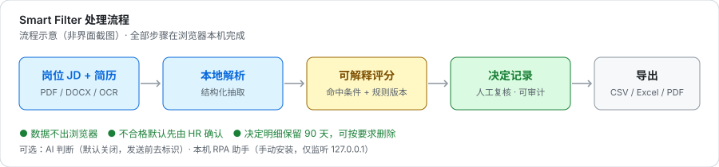
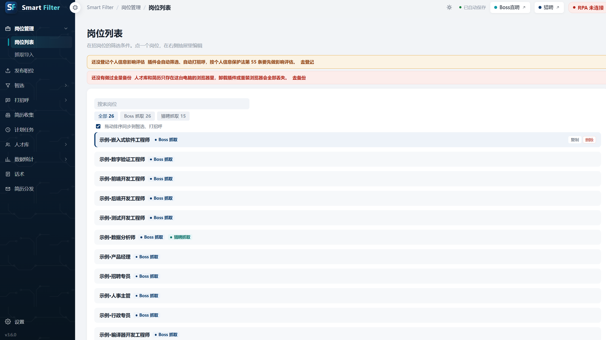
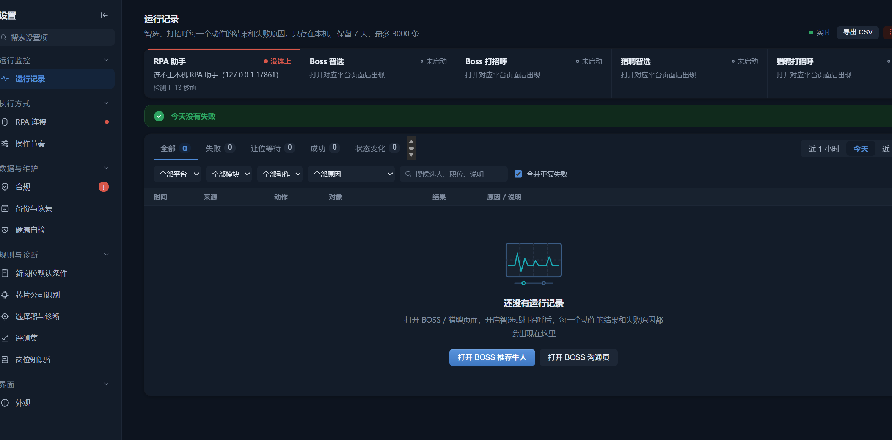

# Smart Filter · Resume Screening with Auditable Decisions

> **An open-source, self-hostable resume screening tool with explainable scoring and a full decision audit trail. All data stays on your machine.**

[中文](./README.md) · [Changelog](./CHANGELOG.md) · [Install](./INSTALL.txt) · [Privacy](./docs/PRIVACY.md) · [Model card](./docs/MODEL_CARD.md)

### Screenshots

| Job Dashboard | Run Log & Audit |
|---|---|
|  |  |

## Why

- Recruiters spend hours on the first pass over hundreds of resumes, with inconsistent criteria.
- Most ATS/SaaS products require uploading candidates' personal data to a third party.
- Black-box scores cannot answer "why was A rejected and B kept?" — decisions become impossible to audit or appeal.

## Highlights

| | |
|---|---|
| 🔒 Local-first | Parsing, scoring and storage run entirely in the browser. No account, no backend. |
| 📄 Parsing | PDF (including scanned, via OCR), DOCX, and online resume pages |
| 🎯 JD-driven | Hard requirements, nice-to-haves and matching rules derived from a job description |
| 📊 Explainable | Every verdict shows matched conditions, rule version and reasoning |
| 🧾 **Decision audit** | One record per decision; rejections require HR confirmation by default; retention limits and deletion on request |
| 📉 Evaluation set | Miss rate / false-positive rate / blind re-review for regression testing rule changes |
| 📦 Export | Talent pool, funnel, weekly report, CSV / Excel / Word / PDF |
| 🏢 Enterprise | Encrypted full backup, offline deployment, group-policy rollout, monthly aggregate reports |

> Scores are decision support only. Final hiring decisions are always made by a human reviewer.

## Quick start (30 seconds)

1. Download and unzip this repository (or grab the zip from [Releases](https://github.com/Bink-citl/-smart-filter-extension/releases/latest)).
2. Open `chrome://extensions` (or `edge://extensions`) and enable **Developer mode**.
3. Click **Load unpacked** and select the folder containing `manifest.json`.
4. Open the workbench → **Import built-in positions** → see 26 **fictional example positions** and the full scoring flow.

On first load, the extension imports `data/preset-backup.json`: a fictional company (`Example Tech`) plus 26 example positions. **No real company, position or candidate data is included.** See [data/README.md](./data/README.md) to replace them.

No build step is required — edit files and click **Reload** in the extensions page.

## Scoring

| Dimension | Basis |
|---|---|
| Job relevance | Match between JD hard keywords and candidate experience |
| Same-role history | Similarity between past titles and the target role |
| Expectation fit | Desired role / city / salary vs the JD |
| Domain knowledge base | Normalization of industry aliases and adjacent roles |

Weights are configurable. **Protected attributes (gender, age, marital status, ethnicity, religion, origin) are never used**, and the example data contains no age or first-degree thresholds. See the [model card](./docs/MODEL_CARD.md).

## Privacy

- Candidate data, resumes, positions, settings and decision logs stay on the local machine; we operate no server.
- Optional AI assistance is **off by default**; users configure their own endpoint, and identifiers are stripped before sending, with a daily cap.
- The optional local RPA helper is installed manually by the user, listens on `127.0.0.1` only, and can be stopped / removed from autostart at any time.
- Full details: [PRIVACY.md](./docs/PRIVACY.md).

## Compliance by design

- Rejected candidates go to a "pending confirmation" queue by default; no automatic rejection.
- Every decision records time, position, verdict, reason, evidence snippets and rule version, exportable for appeals.
- Impact assessment registration, retention-based auto-deletion, and one-click deletion on candidate request.
- De-identification before AI calls and before evaluation-set export.

## Example data

`data/preset-backup.json` contains only fictional examples: company `Example Tech`, 26 positions prefixed with `示例·` (Example), JD bodies labeled as fictional, and no age / first-degree thresholds.

## Contributing

See [CONTRIBUTING.md](./CONTRIBUTING.md) and [CODE_OF_CONDUCT.md](./CODE_OF_CONDUCT.md). Rule templates, matching improvements, docs and translations are all welcome; look for `good first issue`. If this is useful to you, a ⭐ helps a lot.

## Security & license

Report vulnerabilities privately per [SECURITY.md](./SECURITY.md). [MIT](./LICENSE) © 2026 Smart Filter —Bink · Third-party notices: [THIRD_PARTY_NOTICES.md](./THIRD_PARTY_NOTICES.md).

> **Platform terms**: optional automation features interact with third-party recruiting sites. Users are responsible for confirming authorization and compliance. See [docs/AUTOMATION.md](./docs/AUTOMATION.md).
