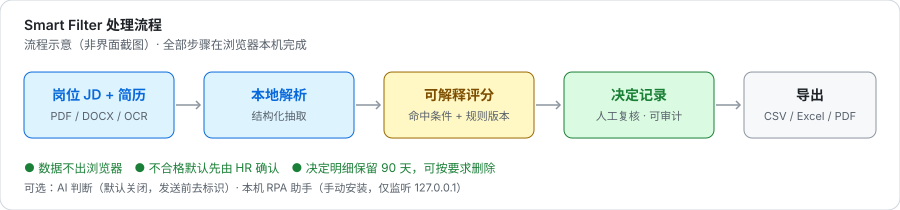
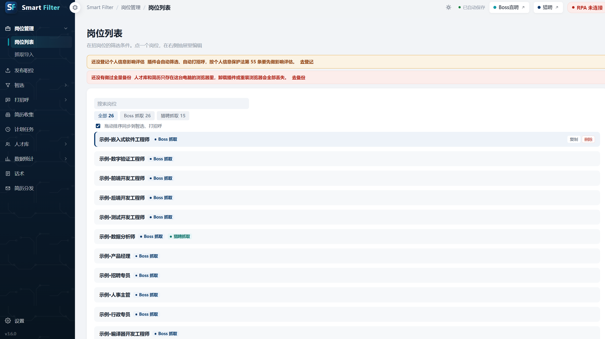
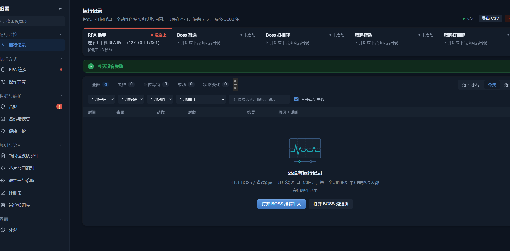

# Smart Filter · 简历智能筛选与决策审计


> **开源、可自托管的简历筛选与决策审计工具 —— 本地解析、可解释评分、每一步决定都可追溯。**

[English](./README.en.md) · [版本记录](./CHANGELOG.md) · [安装说明](./INSTALL.txt) · [隐私政策](./docs/PRIVACY.md) · [模型卡](./docs/MODEL_CARD.md) · [企业部署](./docs/ENTERPRISE.md) · [开源版说明](./docs/OPEN_SOURCE_NOTE.md)



### 界面预览

| 岗位管理（Dashboard） | 运行记录与审计 |
|---|---|
|  |  |

---

## 这是什么

一个运行在 Chrome / Edge 的 Manifest V3 扩展，面向招聘场景：按自定义 JD 筛选候选人、解析简历、给出可解释的评分，并把每一次自动判定完整记录下来供人工复核与审计。

**默认数据 100% 留在本机浏览器**（`chrome.storage`、IndexedDB 与你指定的本地文件夹），项目不运营任何服务端。

## 为什么做这个

- HR 初筛上百份简历靠人工逐张读卡片，耗时长且口径不稳定。
- 在线 ATS 要求把候选人信息上传第三方，很多企业不允许。
- 黑盒打分答不出「为什么淘汰 A 留 B」，招聘决策无法审计、无法申诉。

## 核心能力

| 能力 | 说明 |
|---|---|
| 🔒 本地优先 | 解析、评分、存储默认全部在本机；无账号、无服务端 |
| 📄 多格式解析 | PDF（含扫描件 OCR）、DOCX、页面在线简历 |
| 🎯 JD 驱动 | 从岗位描述生成硬性要求、加分项与匹配规则 |
| 📊 可解释评分 | 逐项展示命中条件、规则版本与判定原因 |
| 🧾 **决策审计** | 每判定一人生成决定记录；不合格默认先由 HR 确认；保留期限与按请求删除 |
| 📉 评测集 | 漏打率 / 误打率 / 盲测复核，规则改动可回归验证 |
| 📦 导出 | 人才库、招聘漏斗、周报、明细 CSV / Excel / Word / PDF |
| ⚙️ 自动化执行 | 可选的本机 RPA 助手与计划任务，见 [自动化说明](./docs/AUTOMATION.md) |
| 🏢 企业就绪 | 全量加密备份、离线部署、组策略分发、月度汇总报告 |

> **辅助决策声明**：本工具仅提供辅助建议，不构成录用或淘汰决定。最终决策须由招聘人员人工复核。

## 30 秒上手

1. 下载并解压本仓库（或从 [Releases](https://github.com/Bink-citl/-smart-filter-extension/releases/latest) 下载 zip）；
2. 打开 `chrome://extensions`（Edge 为 `edge://extensions`），开启「开发者模式」；
3. 点「加载已解压的扩展程序」，选择**含 `manifest.json` 的目录**；
4. 打开工作台 → 「导入内置岗位」→ 立即看到 26 个**虚构示例岗位**与完整评分流程。

首次加载会自动导入 `data/preset-backup.json` 中的示例数据（示例公司「示例科技（Example Tech）」+ 26 个示例岗位）。**这些数据全部为虚构，不含任何真实企业、岗位或候选人信息**，请按 `data/README.md` 替换为你自己的配置。

插件本身**不需要构建**：改完文件在扩展页点「重新加载」即可生效。

## 评分怎么算

| 维度 | 依据 |
|---|---|
| 岗位相关性 | JD 硬性关键词与候选人经历的匹配 |
| 做过本岗位 | 历史职位与目标岗位的一致程度 |
| 期望一致性 | 期望职位 / 城市 / 薪资与 JD 的匹配 |
| 岗位知识库 | 行业别称、相近方向归一化 |

权重可配置，每次判定输出命中依据。**评分维度不包含性别、年龄、婚育、民族、宗教、籍贯等受保护属性**；示例数据未预置任何年龄或第一学历硬门槛。详见 [模型卡](./docs/MODEL_CARD.md)。

## 数据与隐私

- 候选人信息、简历、岗位、设置、决定记录**仅存本机**；我们不运营服务端。
- 可选 AI 判断**默认关闭**；开启后由用户自配端点，发送前按规则去标识（姓名、手机、邮箱、微信号、身份证号），每日调用有上限。
- 可选本机 RPA 助手由用户手动安装、仅监听 `127.0.0.1`，可随时停止并取消开机自启；企业部署前请先经 IT/安全评估。
- 自动决定明细默认保留 90 天、月度汇总（仅数字）保留 3 年，可在设置中调整。
- 完整说明见 [隐私政策](./docs/PRIVACY.md)。

## 合规设计（主要差异点）

- 不合格候选人默认进入「待确认」，HR 确认后才执行后续动作；
- 每判定一人记录时间、岗位、结论、原因、依据片段与规则版本，可导出供申诉；
- 影响评估登记、保留期限自动删除、候选人要求删除时一次清干净；
- AI 调用去标识 + 每日上限；评测集导出前二次去标识，可关闭采集。

## 与其他方案

| | 在线 ATS / SaaS | 通用 AI 打分 | **本项目** |
|---|---|---|---|
| 简历上传第三方 | 是 | 通常是 | 否 |
| 内网 / 离线可用 | 否 | 否 | 是 |
| 评分可解释 | 部分 | 弱 | 逐项可追溯 |
| 决策审计与删除权 | 依厂商 | 少 | 内建 |
| 源码可审计 | 否 | 否 | 是 |

## 示例数据

`data/preset-backup.json` 是插件内置的默认岗位备份，**已全部替换为虚构示例**：

- 公司名：`示例科技（Example Tech）`
- 26 个岗位：`示例·嵌入式软件工程师`、`示例·前端开发工程师` …… 全部带 `示例·` 前缀
- JD 正文标注「虚构数据，非真实招聘信息」；薪资为演示用数值
- 不含年龄/第一学历硬门槛，不含真实姓名、电话、邮箱、客户或内部系统名

替换方法见 [data/README.md](./data/README.md)。

## 目录速览

```
manifest.json          MV3 清单（版本 3.6.0，位于根目录）
background.js          Service Worker
content/               招聘站点内容脚本与浮层
services/              解析、匹配、决定记录、备份、调度等逻辑
options/ dashboard/ popup/ offscreen/   界面
rpa-helper/            可选本机自动化助手（Python）
lib/                   随包分发的第三方库（含 SHA256 清单 VENDOR.json）
data/                  内置示例岗位备份
docs/                  隐私政策、模型卡、自动化说明、企业部署、开源版说明
icons/                 扩展图标
```

## 贡献

见 [CONTRIBUTING.md](./CONTRIBUTING.md) 与 [行为准则](./CODE_OF_CONDUCT.md)。**岗位规则模板、判定规则改进、文档与翻译**都欢迎参与；标有 `good first issue` 的条目适合首次贡献。

如果这个项目对你有用，点一个 ⭐ 是最直接的反馈。

## 安全与许可证

漏洞请按 [SECURITY.md](./SECURITY.md) 私下报告，不要在公开 Issue 中披露。

[MIT](./LICENSE) © 2026 Smart Filter —Bink · 第三方组件见 [THIRD_PARTY_NOTICES.md](./THIRD_PARTY_NOTICES.md)。

---

**平台条款提示**：自动化执行能力涉及第三方招聘平台的服务条款，使用者需自行确认授权与合规性，详见 [docs/AUTOMATION.md](./docs/AUTOMATION.md)。项目作者不对使用方式作任何背书。
